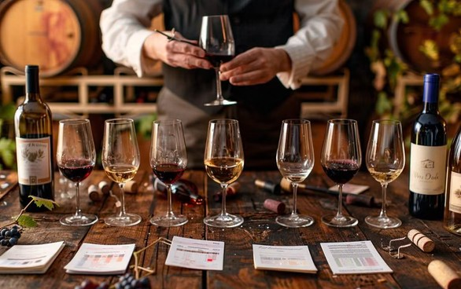

### CCICF E-invoicing 세미나

주프랑스 대한민국 영사관에서 전자 인보이스(E-invoicing)를 주제로 한 CCICF 세미나가 열렸습니다.

CCI France-Corée(CCICF)는 회계법인 Yavrouyan과 함께 주프랑스 대한민국 영사관에서 전자 인보이스를 주제로 한 세미나를 개최했습니다.

전자 인보이스는 기업이 송장을 발행하고, 전송하고, 보관하는 방식을 바꾸고 있습니다. 한국과 프랑스 기업에게는 사내 업무 체계, 도구, 규정 준수, 양국 거래 파트너와의 정보 교환 등 구체적인 과제가 따릅니다.

이번 세미나는 이러한 주제를 점검하고 참석자들이 실무자로서 의견을 나누는 자리였습니다. 한국과 프랑스 간 비즈니스 관계를 증진한다는 CCICF의 취지를 담았습니다.

*2026년 4월 28일 · 주프랑스 대한민국 영사관 (22 Avenue d'Iéna, 75116 Paris)*

### 사랑의 김치 나눔 축제 (재불한인여성회)

재불한인여성회(KOWIN France), 한국문화원, CCICF가 함께한 김치 나눔 축제입니다. 행사에 앞서 6월 11일과 12일 Marne-la-Vallée에서 김치를 함께 담글 봉사자를 모집했습니다.

*2026년 6월 13일 · 한국문화원 (20 rue la Boétie, 75008 Paris)*

### France-Corée : 140 ans d'histoire et d'amitié partagées

2026년 10월 16일, 프랑스 국민의회(Assemblée nationale)에서 한국과 프랑스 간 외교 관계 140주년을 기념하는 심포지엄이 열렸습니다. 정치, 외교, 경제계 인사들이 모여 공유된 역사를 돌아보고 양국 협력의 미래를 함께 고민했습니다.

양국의 외교 관계는 1886년 조선과 프랑스가 최초의 조약을 체결하면서 시작되었습니다. 이후 두 나라는 문화, 무역, 산업 분야에서 관계를 쌓아 왔습니다. 오늘날 이 역사는 끝이 아니라 새로운 출발을 위한 토대입니다.

심포지엄의 핵심 질문은 명확했습니다. 우리가 함께 만들어 갈 미래는 무엇인가. 주요 논의 주제는 경제 협력, 혁신과 기술, 그리고 인적·문화 교류였습니다.

기념일은 지난 역사를 돌아보는 시간입니다. 그러나 실질적인 성과는 이후의 구체적인 프로젝트, 파트너십, 그리고 이를 실현하려는 전문가들의 노력에서 나옵니다. 이 이정표에 기여해 주신 모든 분들께 감사드리며, 앞으로도 함께 만들어 나가겠습니다.

*2026년 10월 16일*

### CCICF 프라이빗 와인 테이스팅

CCICF가 회원 여러분을 위한 프라이빗 와인 테이스팅 행사를 마련했습니다.

와인 전문가의 설명과 함께 샴페인 1종, 화이트 와인 2종, 레드 와인 2종 등 총 5종의 와인을 시음하고, 각 와인의 특징과 매력을 알아보는 시간으로 구성됩니다. 에펠탑 인근의 프라이빗 공간에서 소규모로 진행되는 만큼, 편안한 분위기 속에서 와인을 즐기고 회원 간 교류할 수 있는 특별한 시간이 될 것입니다.

진행은 유튜브 채널 '프랑스와요(FRANCE WAYO)'를 운영하는 와인 전문가 김규학이 맡습니다. 보르도 와인학교에서 소믈리에 과정을 수료하고 학위를 취득했으며, 현지 와이너리와 레스토랑에서 쌓은 경험을 바탕으로 와인에 관한 전문 지식을 쉽고 흥미롭게 전달하고 있고, 유튜브 구독자 4.2만 명, 인스타그램 팔로워 2.2만 명과 소통하고 있습니다.

모집 인원은 날짜별 최대 10명이며 선착순으로 마감됩니다. 회원 등급별 신청 가능 인원은 특별회원 최대 2명, 그 외 회원사 최대 1명입니다.

[참가 신청(구글폼) →](https://docs.google.com/forms/d/e/1FAIpQLSeVPka-oFZwOAmUmm98xLoCSUOvc1OEXcGRYk92HJtp7OkUgg/viewform?usp=publish-editor)

*2026년 11월 25일(수) 저녁 7시 30분, 27일(금) 저녁 7시 30분 · Cave Vino Sapiens (145 Rue Saint-Dominique, 75007 Paris)*

### 제22회 연례총회

주프랑스 한불상공회의소 제22회 연례총회가 개최되었습니다.

*Salon Grand Opéra*

2026년, CCICF는 프랑스에서 한국인이 직업 생활과 사회 생활에 더 잘 정착할 수 있도록 지원을 강화하겠습니다.
