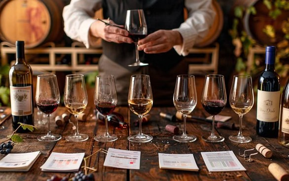

### Séminaire CCICF sur la facturation électronique

La CCI France-Corée (CCICF) a organisé un séminaire consacré à la facturation électronique, au Consulat de Corée du Sud en France, en partenariat avec le cabinet d'expertise comptable Yavrouyan.

La facturation électronique transforme la manière dont les entreprises émettent, transmettent et archivent leurs factures. Pour les entreprises franco-coréennes, elle soulève des questions concrètes : organisation interne, outils, conformité et échanges avec les partenaires des deux pays.

Ce séminaire a permis de faire le point sur ces sujets et d'échanger entre professionnels, dans l'esprit de la CCICF : faciliter les relations d'affaires entre la France et la Corée.

*28 avril 2026 · Consulat de Corée du Sud en France (22 avenue d'Iéna, 75116 Paris)*

### Fête du partage du kimchi (AFCF KOWIN France)

Fête du partage du kimchi organisée avec l'AFCF KOWIN France, le Centre Culturel Coréen et la CCICF. En amont, un appel à bénévoles a été lancé pour préparer le kimchi les 11 et 12 juin à Marne-la-Vallée.

*13 juin 2026 · Centre Culturel Coréen (20 rue la Boétie, 75008 Paris)*

### France-Corée : 140 ans d'histoire et d'amitié partagées

Le 16 octobre 2026, l'Assemblée nationale française à Paris a accueilli un symposium célébrant les 140 ans des relations diplomatiques entre la France et la Corée. Des responsables politiques, diplomatiques et économiques s'y sont réunis pour revenir sur une histoire partagée et s'interroger sur l'avenir de cette coopération.

Les relations remontent à 1886, date du premier traité signé entre la France et la dynastie Joseon. Depuis, les deux pays ont tissé des liens dans la culture, le commerce et l'industrie. Aujourd'hui, cette histoire constitue un socle plutôt qu'un aboutissement.

La question centrale du symposium était simple : quel avenir pouvons-nous construire ensemble ? Trois thèmes sont ressortis : la coopération économique, l'innovation et les technologies, et les échanges humains et culturels.

Les anniversaires sont l'occasion de faire le point. Le travail véritable commence ensuite, dans des projets concrets, des partenariats et la volonté des professionnels de les mener. Merci à tous ceux qui ont contribué à cette étape. Continuons à construire.

*16 octobre 2026*

### Dégustation de vins privée de la CCICF

La CCICF organise une dégustation de vins privée pour ses membres.

Accompagnés des commentaires d'un expert, les participants dégusteront cinq vins au total : un champagne, deux vins blancs et deux vins rouges, pour découvrir les caractéristiques et les atouts de chacun. L'événement se déroule en petit comité, dans un espace privé situé près de la tour Eiffel, pour un moment convivial propice aux échanges entre membres.

La dégustation sera animée par Kim Gyu-hak, expert en vin et fondateur de la chaîne YouTube « France Wayo » (프랑스와요). Diplômé de l'école de vin de Bordeaux (formation de sommelier), il partage avec pédagogie l'expertise acquise auprès de domaines viticoles et de restaurants français, et compte 42 000 abonnés sur YouTube et 22 000 abonnés sur Instagram.

Chaque session est limitée à 10 participants, dans l'ordre d'arrivée des inscriptions. Le nombre de places par société membre dépend de la catégorie d'adhésion : jusqu'à 2 places pour les membres spéciaux, 1 place pour les autres sociétés membres.

[Inscription (formulaire Google) →](https://docs.google.com/forms/d/e/1FAIpQLSeVPka-oFZwOAmUmm98xLoCSUOvc1OEXcGRYk92HJtp7OkUgg/viewform?usp=publish-editor)

*25 novembre 2026 (mercredi) à 19h30 et 27 novembre 2026 (vendredi) à 19h30 · Cave Vino Sapiens (145 rue Saint-Dominique, 75007 Paris)*

### 22e assemblée générale annuelle

La Chambre de Commerce et d'Industrie Corée France a tenu sa 22e assemblée générale annuelle.

*Salon Grand Opéra*

En 2026, nous renforcerons notre engagement en faveur d’une meilleure intégration des Coréens dans la vie professionnelle et sociale en France.
